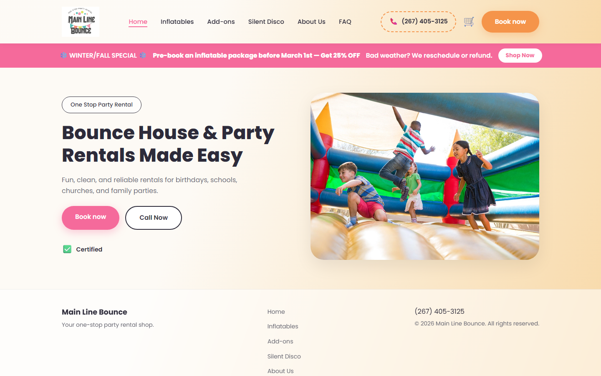
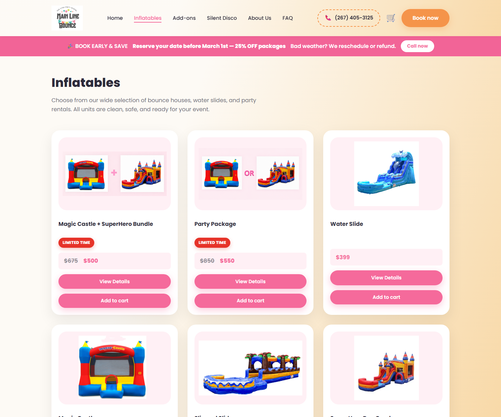
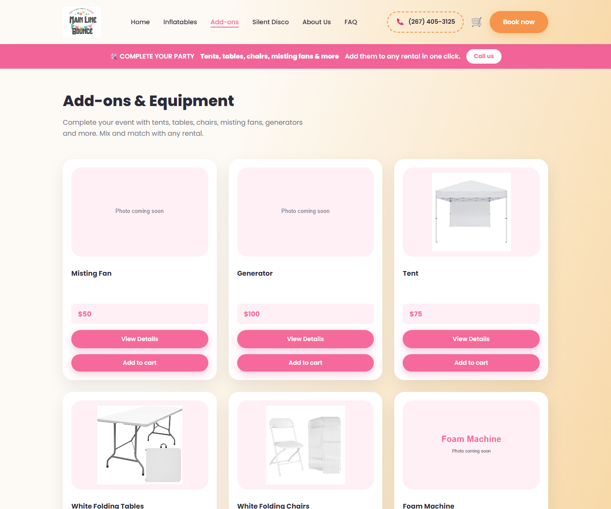
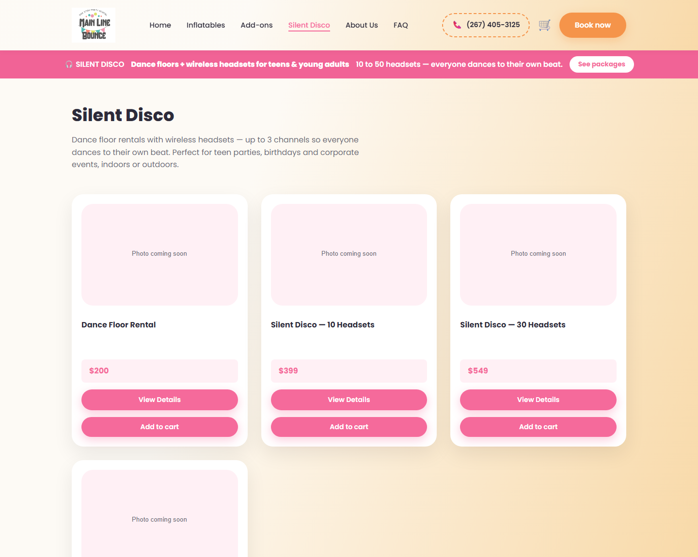
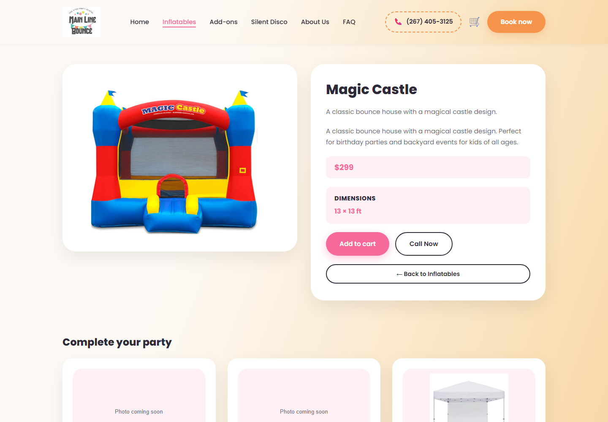
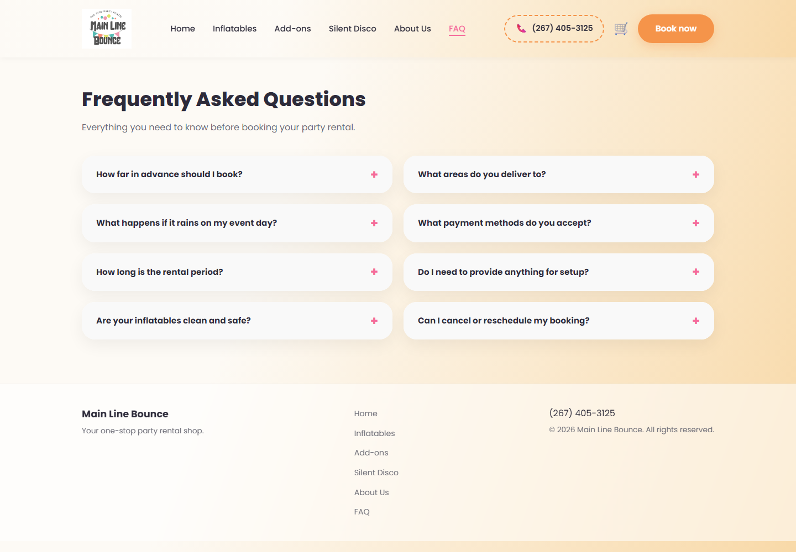
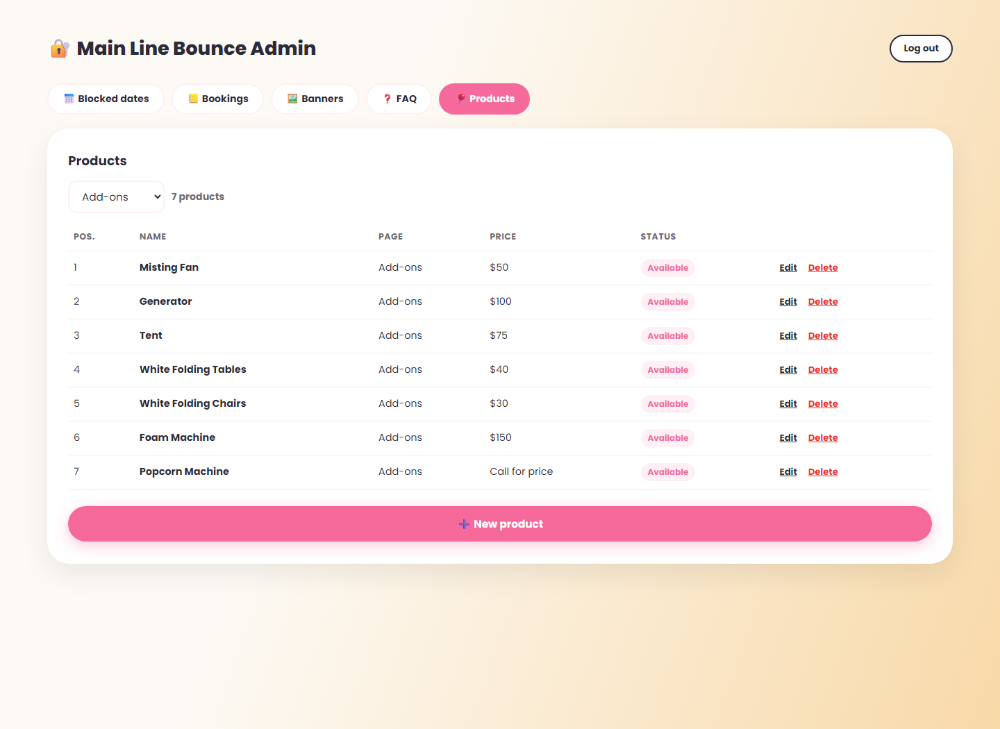
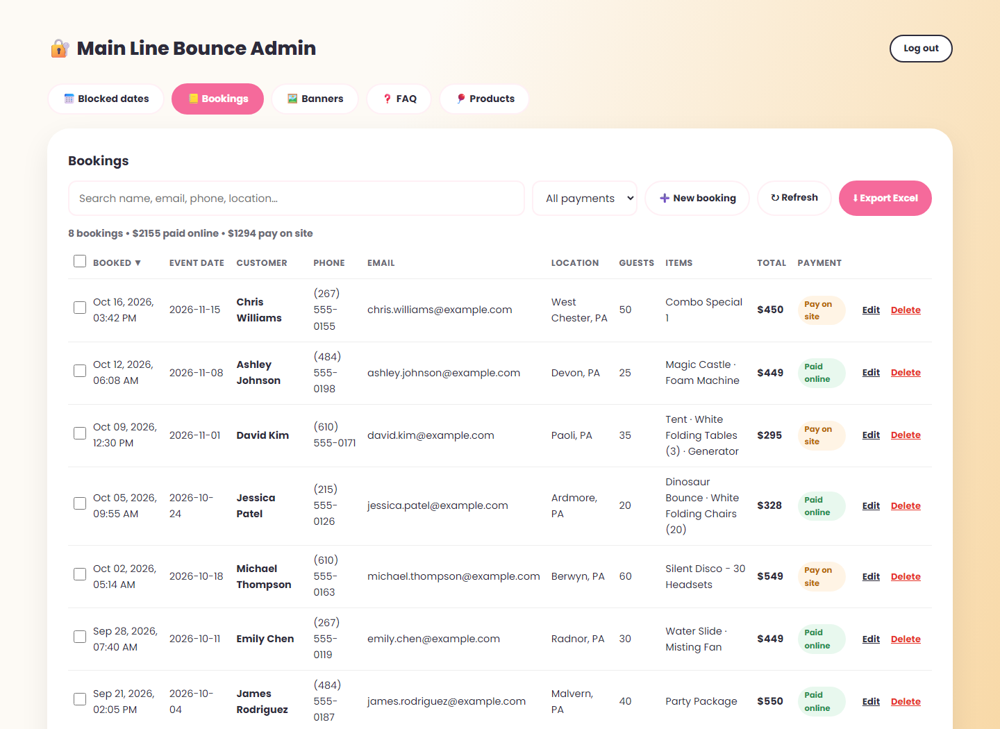
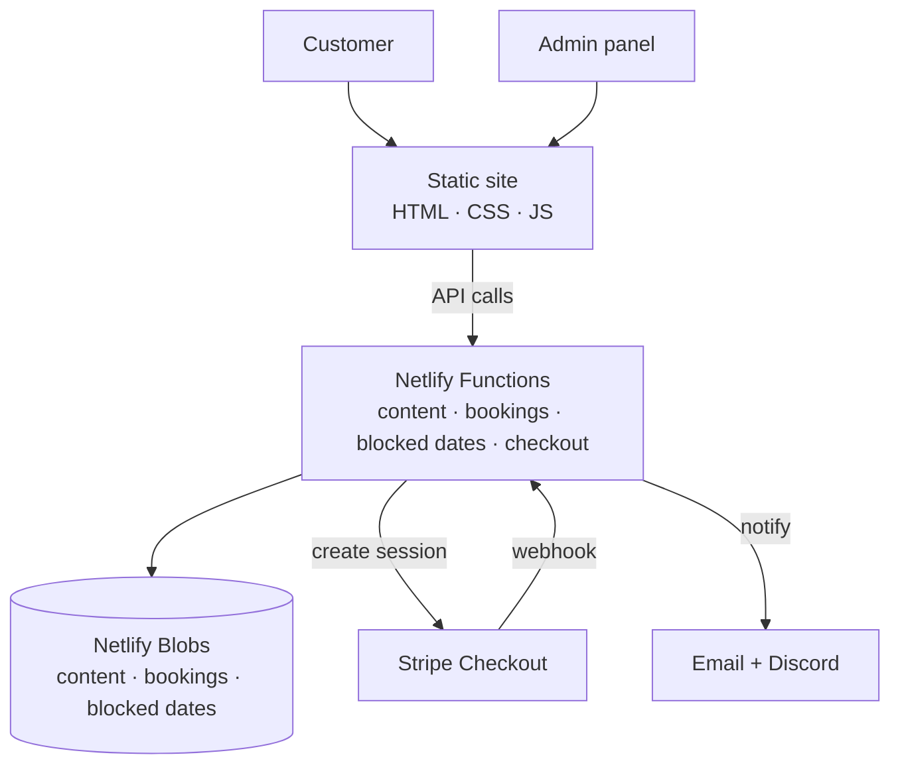

<h1 align="center">Main Line Bounce</h1>

<p align="center">
  <strong>Party rental storefront with a built-in CMS.</strong><br />
  Bounce houses, water slides, silent disco and party add-ons — booked online with Stripe.
</p>

<p align="center">
  <a href="https://mainlinebounce.com"><strong>View the live site</strong></a>
</p>

<p align="center">
  
  
  
</p>

<p align="center">
  <a href="https://mainlinebounce.com">
    
  </a>
</p>

## Overview

A production website for a family-run party rental business on the Philadelphia Main Line.
Customers browse **inflatables**, **add-ons** and **silent disco** packages, build a cart, pick
a date and pay online. The owner manages every price, photo, banner, FAQ entry and booking from
a private admin page — no code changes, no redeploys.

There is no framework and no build step for the website: plain HTML, CSS and vanilla JavaScript
up front, Netlify Functions and Netlify Blobs at the back, Stripe for payments.

- **Storefront:** https://mainlinebounce.com
- **Admin:** https://mainlinebounce.com/admin.html

## Features

**Storefront**

- Three independent collections — Inflatables, Add-ons and Silent Disco — each with its own
  page, ordering and promo banner
- Product detail pages generated from the CMS (`product.html?id=...`)
- Cross-sells: any rental can offer up to six add-ons
- Availability badges, "limited time" badges and "Call for price" items
- Cart, date picker with blocked dates and Stripe Checkout
- FAQ page driven by the CMS, with a static fallback
- Responsive mobile-first layout and Google Ads conversion tracking

**Admin (`/admin.html`)**

- Single private key, verified server side with a timing-safe comparison
- Products: create, edit and delete; page, price, photo, dimensions, badge, availability,
  add-ons and per-page ordering
- Banners: text, title, sub-text, button label and link per page, with an on/off switch
- FAQ: add, reorder and edit questions
- Blocked dates: block a date globally or for a single item
- Bookings: search, filter, sort, edit, delete, multi-select and Excel export
- Everything is persisted in Netlify Blobs — content changes never touch git

## Screenshots

### Storefront

<p align="center">
  
</p>

<table>
  <tr>
    <td width="50%"></td>
    <td width="50%"></td>
  </tr>
  <tr>
    <td width="50%"></td>
    <td width="50%"></td>
  </tr>
</table>

### Admin

<p align="center">
  
</p>

<p align="center">
  
</p>

## Architecture



| Function | Role | Storage |
| --- | --- | --- |
| `site-content` | Banners, products and FAQ (public read, key-protected write) | `site-content` blob |
| `blocked-dates` | Dates blocked globally or for one item | `blocked-dates` blob |
| `bookings` | Admin CRUD for bookings | `bookings` blob |
| `create-checkout` | Creates a Stripe Checkout session | — |
| `stripe-webhook` | Records paid orders, sends notifications | `bookings` blob |
| `send-booking` / `booking-email` | Email and Discord notifications | — |

The frontend keeps working without the backend: `js/content.js` ships a default content set and
renders it when the content API is unreachable, which makes local design work painless.

## Project structure

```text
mainlinebounce/
├── index.html                  Home: hero + editable promo banner
├── inflatables.html            Catalog rendered from the CMS
├── add-ons.html                Catalog rendered from the CMS
├── silent-disco.html           Catalog rendered from the CMS
├── product.html                Dynamic product detail (?id=...)
├── faq.html                    Dynamic FAQ with static fallback
├── cart.html
├── checkout.html               Cart, customer details, Stripe payment
├── success.html
├── about.html
├── admin.html                  Single-page admin panel
├── css/style.css
├── js/
│   ├── main.js                 Navigation, cart, shared UI helpers
│   ├── content.js              CMS renderer (banners, catalogs, product, FAQ)
│   ├── checkout.js             Checkout summary and Stripe redirect
│   └── vendor/
│       └── xlsx.full.min.js    SheetJS, served locally (no CDN dependency)
├── images/
├── netlify/
│   └── functions/
│       ├── site-content.js
│       ├── bookings.js
│       ├── bookings-store.js
│       ├── blocked-dates.js
│       ├── create-checkout.js
│       ├── stripe-webhook.js
│       ├── send-booking.js
│       ├── booking-email.js
│       └── lib/
│           ├── security.js     Auth, rate limiting, input and URL validation
│           └── catalog.js      Server-side catalog and cart validation
├── docs/screenshots/
├── trailer-video/              Self-contained Remotion trailer project
└── netlify.toml
```

## Getting started

Requires **Node 22 or newer**.

```bash
git clone https://github.com/KrustylaD/mainlinebounce.git
cd mainlinebounce
npm install
npx netlify dev
```

The site is served at `http://localhost:8888`, the admin at
`http://localhost:8888/admin.html`.

- The storefront renders with fallback content even without the functions.
- The admin, blocked dates and checkout need `netlify dev` (or a Netlify deploy) for the
  functions and Blobs emulation.

## Environment variables

| Variable | Used by | Description |
| --- | --- | --- |
| `ADMIN_KEY` | `site-content`, `bookings`, `blocked-dates`, admin login | Secret admin key |
| `NETLIFY_SITE_ID` | all functions | Site ID for Blobs access |
| `NETLIFY_BLOBS_TOKEN` | all functions | Personal token for Blobs access |
| `STRIPE_SECRET_KEY` | `create-checkout`, `stripe-webhook` | Stripe secret key |
| `STRIPE_WEBHOOK_SECRET` | `stripe-webhook` | Webhook signature verification |
| `SITE_URL` | `create-checkout`, CORS | Public site URL used for redirects |
| `SMTP_HOST`, `SMTP_PORT`, `SMTP_USER`, `SMTP_PASS` | `booking-email` | Outgoing mail server |
| `SMTP_FROM` | `booking-email` | Sender address |
| `BOOKING_NOTIFICATION_EMAILS` | `booking-email` | Recipients, comma separated |
| `DISCORD_WEBHOOK` | `send-booking` | Optional Discord notification webhook |

The Stripe **publishable** key is set in `js/checkout.js`; it is public by design.

## Payments flow

1. The customer fills in the checkout form and is redirected to Stripe Checkout.
2. Stripe sends a `checkout.session.completed` event to
   `/.netlify/functions/stripe-webhook`.
3. The webhook records the booking in the `bookings` blob and sends the notification email
   (and Discord message, when configured).
4. The booking shows up in the admin, where it can be edited, exported or deleted.
   Bookings added by hand from the admin follow the same storage path.

## Deployment

The repository is built for Netlify:

1. Connect the GitHub repository to Netlify. `netlify.toml` already sets the publish
   directory (`.`), the functions directory and Node 22.
2. Add the environment variables listed above in **Site settings → Environment variables**.
3. Point the Stripe webhook to
   `https://mainlinebounce.com/.netlify/functions/stripe-webhook`.
4. Push to `main` — Netlify deploys the static files and functions automatically.

Content, bookings and blocked dates live in Netlify Blobs, so they survive redeploys and are
independent from the git history.

## Editing the site

Open `/admin.html` and enter the admin key. Each tab maps to one part of the public site:

| Tab | What it controls |
| --- | --- |
| Blocked dates | Dates customers cannot book, globally or per item |
| Bookings | Every order: search, filter, edit, export to Excel |
| Banners | Promo bar text, button and link on each page |
| FAQ | Questions and answers on `/faq.html` |
| Products | The three catalogs and their detail pages |

A few conventions worth knowing:

- **Positions are per page.** Products are ordered independently in Inflatables, Add-ons and
  Silent Disco; inserting an item shifts the slot and renumbers the list.
- **Empty price means "Call for price."** The storefront shows a call button instead of an
  add-to-cart action.
- **Add-ons are products too.** Anything in the Add-ons collection can be offered as a
  cross-sell on another rental (six maximum).
- Stored content is normalized on read, so older records keep working after model changes.

## Security

The site handles payments and customer data, so the code follows a few rules:

- **Server-side pricing.** Checkout and pay-on-site totals are rebuilt from the stored
  catalog; prices, names and totals sent by the browser are ignored.
- **Fail-closed admin auth.** Every admin endpoint requires the `x-admin-key` header,
  compared in constant time. If `ADMIN_KEY` is missing, requests are rejected.
- **Validated input.** Payloads are size-limited, fields are length-capped, emails and
  dates are checked, and CMS links/images are restricted to safe schemes (`https`,
  `http`, `mailto`, `tel`, relative paths).
- **No stored XSS.** CMS content is HTML-escaped when rendered, banner text uses
  `textContent`, and cart data is sanitized before display.
- **Safe notifications.** Emails escape customer input and reject header-injection
  addresses; Discord notifications disable mentions; Excel exports neutralize formulas.
- **Stripe webhook verification.** Signatures are verified against the raw body, unpaid
  sessions are ignored and bookings are idempotent per session ID.
- **Rate limiting.** Checkout, notifications and admin login are throttled per IP.
- **Hardened headers.** `netlify.toml` sets CSP, HSTS, `X-Frame-Options: DENY`,
  `X-Content-Type-Options: nosniff`, Referrer-Policy and Permissions-Policy;
  `/admin` and `/admin.html` are marked `noindex` and `no-store`.
- **Static publishing.** Server sources (`/netlify/*`), package metadata and the
  trailer project are blocked with forced 404 responses.
- **Dependencies.** Node 22, `npm audit` clean, SheetJS served from the repository
  instead of a CDN, and `node_modules/` is no longer committed.

Residual considerations: the CSP still allows `'unsafe-inline'` for scripts and styles
because the existing pages use inline handlers; the admin key lives in `sessionStorage`;
rate limits are per function instance. A stricter setup would move inline scripts to
files and adopt a nonce-based CSP.

## Trailer video (Remotion)

`trailer-video/` is a standalone Remotion project used to produce the marketing trailer.

```bash
cd trailer-video
npm install
npm run studio          # preview
npm run render          # 16:9 trailer  → out/trailer-landscape.mp4
npm run render:vertical # 9:16 trailer  → out/trailer-vertical.mp4
npm run still           # cover image   → out/cover.png
```

Rendered files and `node_modules` are git-ignored.

## Notes

- No build step, no bundler, no framework: the deployed site is exactly what is in the
  repository.
- `js/content.js`, `js/main.js` and `js/checkout.js` are versioned with a query string
  (`?v=`) to bust caches after releases.
- Legacy static product pages are kept for old links; the current catalog always links to the
  dynamic `product.html?id=...`.
